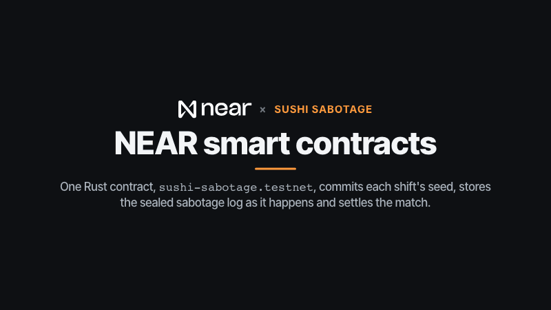
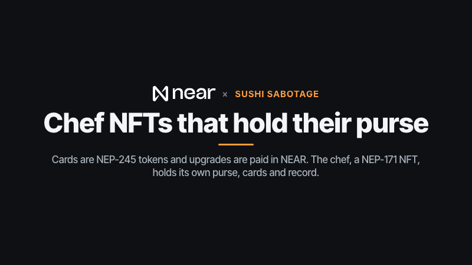
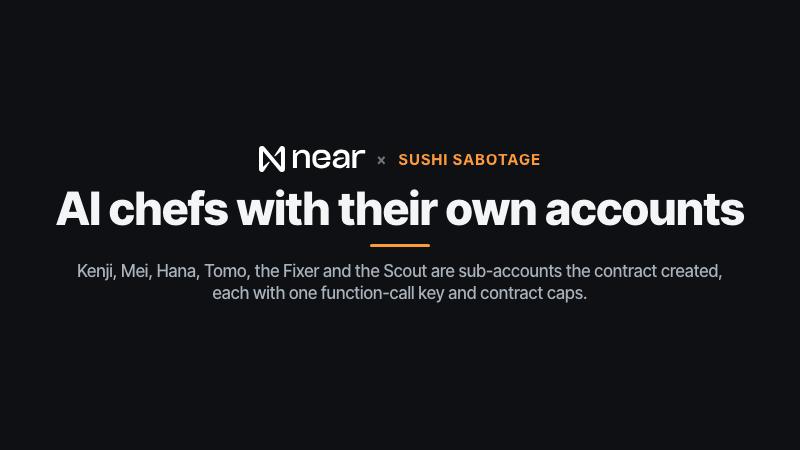
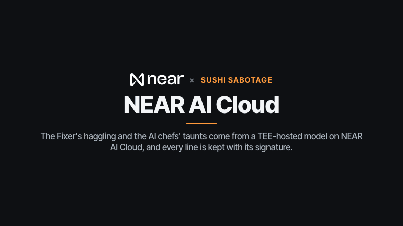
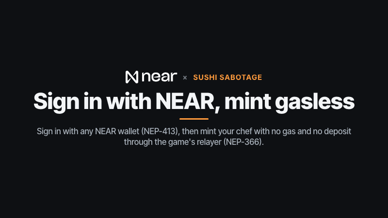
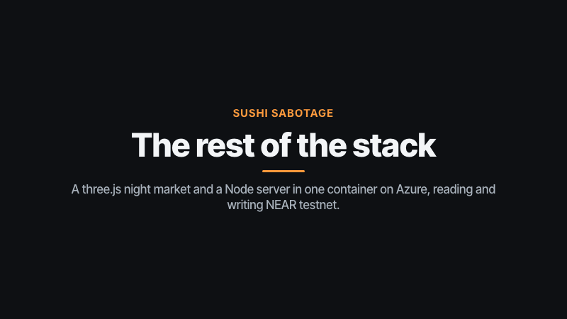

# Sushi Sabotage

Part of the NEAR Arcade submission for NEAR HACKATHON (https://arcade.lopeselio.online, [github.com/lopeselio/near-arcade](https://github.com/lopeselio/near-arcade)); the author's other submission is Signalfire ([github.com/lopeselio/signalfire](https://github.com/lopeselio/signalfire)).

A three-minute sushi kitchen race for 1–4 chefs, in the browser. You cook the same orders as your rivals. You can also wreck their dishes while they cook: drop a wasabi bomb in a rival's pan, swap the fish on their plate, dull their knives. They see the effect, not who did it. When the shift ends, everyone accuses someone. Then the sabotage log, sealed onchain as it happened, is opened and checked by the contract.

The rival chefs are AI agents with their own NEAR accounts. They pay entry fees, buy sabotage cards from the Fixer (another agent), and pay a Scout agent for reports on the leader. Every chef is an NFT that holds its own purse, cards and record.

Built for NEAR HACKATHON (Nov 2026). Tracks: **Games With Real Economies**, **Privacy & Private AI**, **Agent Economy**, **NFTs That Do Something**. Design: [DESIGN.md](DESIGN.md).

- Contract (testnet): [`sushi-sabotage.testnet`](https://testnet.nearblocks.io/address/sushi-sabotage.testnet). The referee is [`sushi-sabotage-ref.testnet`](https://testnet.nearblocks.io/address/sushi-sabotage-ref.testnet).
- Agents (sub-accounts, each with only a function-call key): `kenji`, `mei`, `hana` and `tomo` (AI chefs), `fixer` (sells cards) and `scout` (sells reports), all `.sushi-sabotage.testnet`.

## Try it (do X, see Y)

Hosted demo: **https://sushi-sabotage.lopeselio.online/** (Azure Container Apps), also in the NEAR Arcade at https://arcade.lopeselio.online/. Health: [`/api/status`](https://sushi-sabotage.lopeselio.online/api/status) shows the deployed version, the contract's free storage NEAR and how long it lasts, and every agent's balance; `warnings` is empty when all is well. Locally:

```bash
pnpm install
pnpm --filter @sushi/web build
pnpm start            # http://localhost:8787 (server + built web app)
```

Without NEAR keys, run `CHAIN=0 pnpm start`. Everything plays the same, but nothing is written onchain.

1. **First visit.** Open the page. You see the title screen (logo, chef name, **Solo shift** and **Multiplayer**) and, on top of it, four welcome cards: what the game is, cook → plate → deliver, sabotage and Mischief, whodunit and the chain. **Next** / **Back** (or the arrow keys) move between them, **Skip** closes them. The last card's **Play my first shift** starts a solo shift against three Easy AI chefs. Your browser remembers that you've seen them (`sushi.onboarded`); **The intro again** under the play cards shows them again.
2. **Play a solo shift.** Type a chef name, pick how many rivals and an **AI chefs: Easy / Normal / Hard** level, and press **Start shift** (it says **Start my first shift** until you've done the walkthrough).
   - The level is remembered in your browser. Until you pick one, a first-timer gets Easy, otherwise Normal.
   - Easy chefs are slow, burn things and rarely sabotage; Normal ones are about as quick as an average player; Hard ones sabotage early and gang up on whoever leads. Against three of them an average player wins roughly 60 % / 40 % / 20 % of shifts (`pnpm balance`, below). The results screen says which level you played. A **ranked** shift (entry fee at stake) never runs on Easy: it plays at Normal, so nobody can farm the AI chefs' fees.
   - You see an AI chef's taunt. With a NEAR AI key set, it's "signed by a TEE model on NEAR AI".
   - Then a 3-second countdown, and your stall on a night-market street with three rival stalls.
   - **WASD** to move, **E** to pick up or put down, **F** to chop. Order tickets appear top-left; each has a patience bar that turns amber, then red. The clock, the scoreboard (click a rival to target them) and the **?** (How to play), 💡 (hints) and 🔊 buttons are top-right. Your Mischief pips, the target and the six cards are at the bottom; what you hold and any effects on you (soy slick, dull knife, shield, streak) are bottom-left.
   - **Your first solo shift has a walkthrough.** A coach panel on the left waits for you to do each thing before it moves on: walk (it ticks off once you've moved), then **Cook your first dish**, which follows the yellow arrow and shows the skill the next step needs (grab a plate, grab an ingredient, cook it, chop on a board, build the dish, serve it) with a checklist that ticks off as you actually do each one. Then **Pick a target** (press **Tab**), **Play a card** (press **1–6**; the first dish gives you one pip), **Spy on the street** (**V**, then **V** again) and **Finish**. **Skip step** and **Skip tutorial** are always there. The walkthrough runs once (`sushi.tutorialDone`); **How to play → Replay tutorial** brings back the welcome cards and the walkthrough.
   - On your first three shifts a yellow arrow and a **Next** box (left, under the tickets) show the next step for the most urgent order ("Grab a plate from the rack", "Put the raw rice in the rice cooker", …). **H** or 💡 toggles them. The hints come from the AI chefs' own planner.
   - **?** (or the **?** button, or **How to play** in the top bar) opens the How to play sheet: controls, the cooking chains, all 20 recipes, the six cards, scoring, whodunit and the proof. In an unranked solo shift the kitchen pauses while it's open. **Esc** or **Got it** closes it.
3. **Cook a dish.** For *Azure Fin Maki*:
   - **Rice:** raw rice → cooker (3 s) → board (3 chops) = sushi rice.
   - **Base:** nori sheet → board (3 chops) = nori roll.
   - **Fish:** fish → board (3 chops) → pan (3 s) = seared fish. Take it off within 5 s or it burns.
   - **Plate it:** take a plate from the rack, put it on a counter, add the three, and carry it to the hatch at the front. A big "+points" floats up over your stall, your row on the scoreboard bumps, the ticket leaves the rail, and one Mischief pip lights up at the bottom.
4. **Sabotage.** With Mischief charged, press **Tab** (or click a rival on the scoreboard) to pick a target, then **1–6** for a card. Cards you can afford light up; each shows its key and its cost in pips.
   - A banner says "You played Dull Knife on Mei. They won't know it was you." The rival's stall flashes red.
   - The AI chefs do the same to you: a red banner, "Someone hit you with Wasabi Bomb!", and the effect shows bottom-left (for example "Dull knife 9s"). A Bamboo Shield turns it into a green "Shield up!".
   - **V** shows all four kitchens at once.
5. **Shift end.** If anyone hit you, you get **Whodunit?** first: name a suspect for each hit. Then the page says "The referee is re-running your shift to check it…". The server replays your input log through the same deterministic sim, then you see:
   - a podium with the top three chefs in their colours (you're outlined), and **Play again** to start the same shift setup;
   - "✓ The referee re-ran your shift from the input log and reached the same state";
   - the results table (in an unranked solo shift your accusations score; in a ranked one they don't, because your browser ran the sim and could know the culprits);
   - **the sealed sabotage log, opened**: who hit whom, with what, and when;
   - links to `create_match`, `seal xN` and `settle_match` on nearblocks.

   In `settle_match`, the contract checks every opening against its seal and pays out.
6. **The proof.** **Proof bundle (JSON)** opens `/api/match/<id>`. It holds:
   - the seed, whose hash was committed at `create_match`;
   - the full input log;
   - every seal and its opening (salt included), and the accusations;
   - the signed NEAR AI lines.

   Check any finished match yourself with no keys: `pnpm verify <matchId>` (after `pnpm install`). It fetches the bundle from the hosted game and the contract's record, then checks the seed against its committed hash, every seal against its opening, re-runs the shift from the input log, and compares the final scores with the contract. A known-good hosted match, a guest solo shift settled on 2026-11-12 (run against https://sushi-sabotage.lopeselio.online the same day):

   ```
   $ pnpm verify m-mwdktpbw-5271a2
   match m-mwdktpbw-5271a2 — Judge Guest, Kenji, Mei, Hana

   ✓ the contract has this match
   ✓ the contract settled it
   ✓ seed matches the hash committed at create_match  b1becd900b805749
   ✓ the sim setup uses that seed
   ✓ rules version and difficulty match what the seed committed to  rules v3, AI chefs normal
   ✓ chef upgrades in the setup are the ones the contract recorded at create_match  none
   ✓ the 4 seals in the bundle are the ones posted onchain
   ✓ every opening hashes to its seal
   ✓ replaying the input log reaches the recorded end state  2744bf05a9709d80
   ✓ the replay casts exactly the 4 sealed sabotages, in order
   ✓ final scores from the replay match the contract  [-105, 167, 74, 60]

   unranked: no entry fees
   1 AI line(s), 1 signed by the NEAR AI enclave (signer 0xfdbd7952498b333206f360d71d97a1e0961e8ddf)

   all checks passed
   ```

   - Any other match: pick an id from [`/api/matches`](https://sushi-sabotage.lopeselio.online/api/matches) (the 20 newest; the AI league adds one every 15 minutes) or from a results screen.
   - RPCs: the contract is read through intea, drpc and fastnear in turn; a rate-limited endpoint (429) is skipped and the list retried after a pause. `--rpc https://…` puts your own endpoint first (repeat it or comma-separate several). If nothing answers you get one line naming each endpoint tried. Other options: `--host` (default the hosted game), `--contract`.
   - AI-league rounds are pruned from contract storage 12 h after they start (see "Deploying"); verifying an older league round says so and links its transactions. Player shifts are never pruned.
7. **Multiplayer.**
   - **Create room** gives you a 4-letter code. Open a second browser window, enter the code and press **Join**.
   - The host can **Add AI chef** and pick the **AI chefs** level (Easy / Normal / Hard); the other players see it. Everyone presses **Ready**. A player who leaves mid-shift is taken over by an AI chef at that level.
   - The server runs the shift at 20 Hz. Neither window ever receives the caster of a sabotage: check `/ws` frames in devtools, where the caster is `-1`.
   - After the shift comes **Whodunit?**: for each hit, pick a suspect. Right is +40 to you and −40 to them; wrong is −10.
   - The contract scores the accusations itself in `settle_match`.
8. **Your Chef NFT** (needs a NEAR testnet wallet; free).
   - After a guest shift the results screen invites you to **Sign in with NEAR**. Pick a wallet (NEAR Connect: Meteor, Intear, HOT, MyNearWallet, …). The wallet signs one message, "Sign in to <this host>" (NEP-413), and Better Auth with the better-near-auth plugin starts a session cookie.
   - Press **Mint your chef — free** (on the title screen, the results screen or **My Chef**) and approve it in the wallet. No deposit and no gas: the wallet signs a NEP-366 meta-transaction, the game's relayer (`sushi-sabotage-relay.testnet`, limited to this contract, no deposits) submits it, and the contract pays the storage. Claiming the faucet, enabling ranked and buying cards work the same way. Gameplay itself never touches the wallet.
   - You see the chef card: the contract-drawn NFT image, level and XP bar, stats, purse (100 ryo), cards, **energy 1000/1000** and four **upgrades**. It updates after every shift.
   - **Energy:** each recorded shift costs 100 and it refills by itself at 100 an hour. With less than 100 your shift still plays, as an unrecorded guest shift. **+300 energy · 0.1 NEAR** buys a pack.
   - **Upgrades:** Knife (some chops cut twice), Pan (food burns later), Sandals (walk faster), Apron (sabotage wears off sooner), levels 1–5 for 0.05 / 0.1 / 0.2 / 0.3 / 0.5 NEAR, higher levels needing a higher chef level. Ranked shifts count at most level 3. Your next shift's setup carries them (`gear` in the proof bundle), and `pnpm verify` checks them against what the contract recorded.
   - Purchases attach NEAR, so they are ordinary wallet transactions (the gasless relayer never carries payments); the page says so before your wallet opens. The NEAR goes to the contract's treasury (`get_economy`). Numbers and fairness: [DESIGN.md, "Energy and upgrades"](DESIGN.md#energy-and-upgrades-paid-in-testnet-near).
   - **Claim daily 50 ryo** adds to the purse. **Enable ranked (10 ryo/match)** lets the referee charge an entry fee into the prize pot.
   - The same flow without a wallet app, against the live contract: `pnpm --filter @sushi/server e2e` creates a test account (from the faucet, or set `E2E_FUNDER=<account>` when the faucet is rate-limited) and runs sign-in → mint → **buy a knife upgrade with 0.05 NEAR** → faucet → ranked approval → haggle → buy a card → a shift with the card and the upgrade (checked in the setup and onchain) → settlement → NEP-245 card transfer → **buy an energy pack with 0.1 NEAR**. A run on 2026-11-10: [buy_upgrade](https://testnet.nearblocks.io/txns/CpG5gu5YDJw9LBG7Lk84gpmJ9nQ6CvhgnddeWkDUh8qz), [buy_energy](https://testnet.nearblocks.io/txns/D3C2ZruhMjZHRPB2euMVZMHE5ddii1jPx92Pf4REfxDd), [mint (gasless)](https://testnet.nearblocks.io/txns/RiPiBZRnmXMmxo6jdZKxjqEF5LLAh1gCdqdeZtC9cg4).
9. **The Night Market.**
   - Pick a card and offer a price, optionally with a line of text. The Fixer answers in character.
   - The **price comes from `packages/rules/src/market.ts`**: demand raises it, it decays over an hour, and there's one counter-offer with an 80 % floor. The model only does the talking.
   - On accept, the Fixer agent posts an onchain offer, and your browser accepts it. The page shows the receipt, and the card lands in your chef NFT's inventory.
   - Cards are also **NEP-245 multi-tokens** (`mt_balance_of`, `mt_transfer`, `mt_batch_transfer`, `mt_transfer_call`, `mt_supply`): your balance is your chef's inventory, so players can trade cards. Buying mints one; bringing it into a match burns it.
10. **The AI league.** Every 15 minutes three AI chefs play a full shift against each other with nobody watching (on rules v1, each at its own persona level: Kenji hard, Mei and Hana normal, Tomo easy). Ranked league shifts put entry fees into the pot, with prizes and recipe-scroll royalties paid by the contract and the season leaderboard moving. The server paces the chefs' contract-capped budget by itself (`apps/server/src/budget.ts`): 60 ryo of each chef's day is kept for ranked shifts against people, the rest is spread evenly over the UTC day as ranked league shifts with the chefs who have the most budget left seated, and the rounds in between are friendly exhibitions. The **Agents** page shows each chef's budget left today. The **Agents** page lists each league result with its settle transaction, and **Leaderboard** shows the standings.
11. **The agents.** The **Agents** page lists each agent account and the receipts of what they did on their own (every 10 minutes):
   - claim the faucet;
   - buy their favourite card from the Fixer;
   - pay Scout Nori 5 ryo for a report on the current leader.

   A scouted leader becomes that AI chef's preferred sabotage target in the next shift.

   Each receipt links its transaction. A league result (winner, pot) is listed only once `settle_match` went through. An action that failed onchain is marked **✗** with the reason in words (for example "the contract is out of storage NEAR"), and nothing was spent or won. If the contract is short of storage NEAR, a warning sits above the receipts.

## Built on NEAR

What each NEAR technology does in Sushi Sabotage, and where to look. Each GIF is a short loop (12 seconds or less).

| Technology | What Sushi Sabotage uses it for | Where to look |
|---|---|---|
| NEAR smart contracts (Rust, near-sdk 5.29) | the kitchen contract: the seed committed at `create_match`, sabotage seals during the shift, `settle_match` checking every opening, `prune_matches` for old league rounds | [`contracts/kitchen`](contracts/kitchen/src/lib.rs), [`sushi-sabotage.testnet`](https://testnet.nearblocks.io/address/sushi-sabotage.testnet), referee [`sushi-sabotage-ref.testnet`](https://testnet.nearblocks.io/address/sushi-sabotage-ref.testnet) |
| NEP-171 NFTs, NEP-245 multi tokens | chef NFTs that hold their own purse, cards and record; recipe scrolls with purses; sabotage cards as NEP-245 tokens; upgrades and energy paid in NEAR | [`lib.rs`](contracts/kitchen/src/lib.rs), [`mt.rs`](contracts/kitchen/src/mt.rs), [`econ.rs`](contracts/kitchen/src/econ.rs) |
| NEAR accounts and function-call keys | AI chefs, the Fixer and the Scout are sub-accounts the contract creates, each with one function-call key and contract spending caps | `create_agent_account`, `register_agent` in [`lib.rs`](contracts/kitchen/src/lib.rs), [`agents.ts`](apps/server/src/agents.ts), [`budget.ts`](apps/server/src/budget.ts) |
| NEAR AI Cloud | the Fixer's haggling and the AI chefs' taunts, from a TEE-hosted model, each line kept with the enclave's signature | [`nearai.ts`](apps/server/src/nearai.ts), [`/api/attestation`](https://sushi-sabotage.lopeselio.online/api/attestation) |
| NEP-413 sign-in, NEP-366 meta-transactions | wallet sign-in (Better Auth + better-near-auth); a gasless chef mint, faucet, ranked approval and card purchase through `sushi-sabotage-relay.testnet` | [`apps/web/src/wallet.ts`](apps/web/src/wallet.ts), [`apps/server/src/ba.ts`](apps/server/src/ba.ts) |

### NEAR smart contracts: sealed sabotage



One Rust contract, [`sushi-sabotage.testnet`](https://testnet.nearblocks.io/address/sushi-sabotage.testnet), records every match. `create_match` stores `sha256(seed)` with the seats, fees, cards and gear; during the shift the referee posts each card cast as `sha256(match|caster|target|card|tick|salt)` with `seal` ([`match.ts`](apps/server/src/match.ts)). `settle_match` refuses unless the seed matches its hash and every seal is opened in order, then scores the accusations itself and pays out ([`lib.rs`](contracts/kitchen/src/lib.rs)); `prune_matches` frees AI-league rounds 12 hours after they start ([`prune.ts`](apps/server/src/prune.ts)). `pnpm verify <matchId>` checks a match against the contract with no keys.

### NEP-171 and NEP-245: chefs that hold their purse



A chef NFT is the player's account: its purse, card inventory, stats and best score live on the token, its metadata (an SVG card) is generated from that state on every read, and `nft_transfer` moves all of it ([`lib.rs`](contracts/kitchen/src/lib.rs)). Sabotage cards are NEP-245 tokens whose balance is the chef's inventory ([`mt.rs`](contracts/kitchen/src/mt.rs)); the 20 recipe scrolls have purses of their own and earn royalties in ranked matches. `buy_upgrade` and `buy_energy` take NEAR into the treasury counted by `get_economy` ([`econ.rs`](contracts/kitchen/src/econ.rs)).

### Agent accounts: AI chefs with their own keys



`create_agent_account` makes `kenji`, `mei`, `hana`, `tomo`, `fixer` and `scout` sub-accounts of the contract whose only key is a function-call key for five methods; they can't move NEAR or call other contracts. `register_agent` puts each chef under caps that `spend()` checks on every purchase and entry fee, and the server paces the budget ([`budget.ts`](apps/server/src/budget.ts)). On their own, the agents claim the faucet, buy cards and pay the Scout ([`agents.ts`](apps/server/src/agents.ts)).

### NEAR AI Cloud: signed taunts and haggling



The AI chefs' taunts and the Fixer's lines come from `Qwen/Qwen3.6-35B-A3B-FP8` on NEAR AI Cloud ([`nearai.ts`](apps/server/src/nearai.ts)), kept with their exact request and response bytes and the enclave's signature in the match's proof bundle. The price comes from [`market.ts`](packages/rules/src/market.ts), never from the model, and the model never moves a chef or picks a target. [`/api/attestation`](https://sushi-sabotage.lopeselio.online/api/attestation) returns a fresh attestation report bound to a nonce.

### Wallet sign-in and gasless mints: NEP-413 and NEP-366



Sign-in is Better Auth with better-near-auth ([`ba.ts`](apps/server/src/ba.ts), [`wallet.ts`](apps/web/src/wallet.ts)): the wallet signs "Sign in to <this host>" and the server sets a session. Minting a chef, the faucet, ranked approval and buying a card go out as NEP-366 delegate actions that `sushi-sabotage-relay.testnet` submits, only to the kitchen contract and never with a deposit. Upgrades and energy attach NEAR, so the wallet sends them as normal transactions; gameplay never touches the wallet.

### The rest of the stack



A three.js night market built with Vite ([`apps/web`](apps/web/src/scene.ts)), a Node 22 server that runs rooms over WebSocket at 20 Hz, the referee, the agents and NEAR AI ([`apps/server`](apps/server/src/main.ts)), and [`packages/rules`](packages/rules/src/sim.ts), the deterministic sim that the browser, the server and `pnpm verify` all run. One image ([`Dockerfile`](Dockerfile)) runs on Azure Container Apps; every 3D model comes from [`tools/blender`](tools/blender/build_assets.py).

## How it works

```
apps/web          three.js night market (Vite, TS), HUD, NEAR Connect wallet, guest play
apps/server       rooms over WebSocket (authoritative 20 Hz sim), solo replay check, referee, agents, NEAR AI
packages/rules    deterministic sim: 20 recipes, stations, orders, sabotage, scoring, AI chefs, market pricing
contracts/kitchen Rust near-sdk 5.29: chef + recipe-scroll NFTs (NEP-171) with purses, offers, agent caps, matches, seals, settlement
tools/blender     bpy scripts that build every 3D model (.glb) and its preview: stations and chef, and every ingredient in every cooking state
```

- **Deterministic rules.**
  - `packages/rules` uses no `Math.random`, `Date` or DOM. The same setup and input log give the same state hash, and tests check this.
  - The AI chefs are deterministic planners inside the sim (`bot.ts`). They play by sending the same inputs a human does.
  - The language model never moves a chef, picks a target or sets a price.
- **Sealed sabotage (privacy).**
  - Each card cast during a shift becomes `sha256(match|caster|target|card|tick|salt)`. The referee posts these with `seal` every ~3 s.
  - At the end, `settle_match` gets every opening. The contract refuses the settlement unless:
    - the seed matches the hash committed at `create_match`;
    - every seal is opened, in order, and matches.
  - It then scores the accusations itself.
  - In multiplayer, the server strips the caster from every client's view.
  - In solo, your browser runs the sim, so it could know the culprits. That's why only the AI chefs' accusations score in solo.
- **Private AI.**
  - The Fixer's haggling and the AI chefs' taunts come from a TEE-hosted model on NEAR AI Cloud.
  - Each reply is stored in the match's proof bundle with its exact request and response bytes and the enclave's signature.
  - `/api/attestation` returns a fresh attestation report bound to a nonce.
- **Agent economy.**
  - Agents are sub-accounts created by the contract (`create_agent_account`) with a single function-call key. It's limited to `post_offer`, `accept_offer`, `buy_scout`, `approve_referee` and `claim_daily`.
  - `register_agent` puts the agent's chef under caps: 150 ryo/day, 10 ryo per match entry. `spend()` enforces them on every purchase and entry fee. The server checks the cap before seating an agent in a ranked match and paces the budget (a player reserve, league shifts spread over the day, cards and scouting only from what's spare).
  - `/api/status` shows each agent's balance and remaining key allowance; `node scripts/top-up.mjs` refills balances from the owner account.
  - Agents can't move NEAR or call other contracts.
- **NFTs that do something.**
  - A Chef NFT is the account: its purse, card inventory, stats and best score are stored on the token. `nft_transfer` moves all of it.
  - Metadata is generated from that state on every read: title "Name · Title · Lv N", an SVG card and an `extra` JSON.
  - The 20 **Recipe Scrolls** each have their own purse. In ranked matches, 2 ryo per delivered dish go from the pot to that recipe's scroll, capped at 30% of the pot so there's always a prize. The AI chefs own 16 of them, so agents earn passive income. `move_purse` moves a scroll's earnings into your chef.
  - Sabotage cards are NEP-245 tokens held by the chef NFT (see step 8).
- **Chain invisible.**
  - Guests play with no wallet.
  - Signed-in players never sign gameplay. The few things that are theirs to approve (mint, faucet, ranked approval, buying a card) are gasless meta-transactions relayed by the game.
  - The referee pays for every match transaction.

### What the chain does *not* prove

- During a multiplayer shift, the game server runs the sim, so it sees every input. It also holds the agents' keys.
- Shift scores are reported by the referee. They're reproducible from the public input log (`replay()` in `packages/rules`), but the contract doesn't re-run the sim.
- Moving the referee into a TEE would close that gap. It isn't done.
- In solo, your browser runs the sim, so it could know who sabotaged you; that's why your own accusations don't score in ranked solo shifts.

## Tests

```bash
pnpm --filter @sushi/rules test     # sim, sabotage, accusations, replay determinism, market, hints, difficulty, frozen v1 and v2 replays, chef upgrades
pnpm contract:test                   # 36 contract tests: NFTs, transfers, offers, caps, seals, settlement, royalties, NEP-245, energy, upgrades, treasury, migration, pruning
pnpm sim 10                          # headless AI-only shifts: balance check
pnpm balance 400                     # a reference human vs 3 AI chefs at v1 / easy / normal / hard: win rate, dishes, sabotages
pnpm verify <matchId>                # re-run a finished match and check it against the contract (and its chef upgrades, rules v3)
pnpm --filter @sushi/server e2e      # the whole signed-in player flow on testnet with a fresh faucet account
pnpm --filter @sushi/server test     # budget pacing, storage runway, pruning policy, readable chain errors
```

The e2e chefs are named "E2E Chef"; they stay on the contract's board but the game's leaderboard leaves them out.

## Deploying

- **Contract:** `pnpm contract:build`, then `near contract deploy sushi-sabotage.testnet use-file contracts/kitchen/target/near/sushi_sabotage_kitchen.wasm with-init-call new json-args '{"owner":"sushi-sabotage.testnet","referee":"sushi-sabotage-ref.testnet"}' …`.
- **Agents:** `pnpm --filter @sushi/server setup:agents`. It creates the six agent accounts with function-call keys, registers them, approves fees and mints the 20 scrolls. It is idempotent.
- **Hosting:** `scripts/deploy-azure.sh`. One Docker image runs on Azure Container Apps (one replica: rooms live in memory); the server serves the web app. `scripts/azure-storage.sh` mounts an Azure Files share at `/data`, so proof bundles survive restarts and redeploys.
- **Contract storage:** every stored byte locks 0.00001 NEAR, and a settled match is about 1.5 KB. The referee prunes AI-league rounds 12 h after they start (`prune_matches`, every 30 minutes; `PRUNE=0` turns it off), so league storage stays at about 0.7 NEAR while player matches are kept. `/api/status` → `contract` shows the free NEAR, growth per day, the run-out date and the top-up needed to last until `HOSTED_UNTIL` (default 2026-11-25). The server logs `ALERT:` and adds a warning there when it falls short; top up by sending NEAR to `sushi-sabotage.testnet`.
- **Upgrading the contract:** `near contract deploy sushi-sabotage.testnet use-file … without-init-call …` when the state layout is unchanged, then `mt_reindex_supply` once if card supply needs recounting. The energy/upgrades release changed the root layout and was deployed with `… with-init-call migrate json-args '{}' …` ([tx](https://testnet.nearblocks.io/txns/E9LsipP6meKdsNRBUjhMarDZ7weQK8XAvzkUPqeHZn7U)); `migrate` is tested against the live testnet state bytes and refuses to run twice.

## Lineage, reuse and disclosures

- **Our earlier game.** Recipes, ingredient chains and the chef/session/leaderboard idea come from **Sushi Bonks** (Unity, Monad testnet: https://github.com/IntoTheVerse/sushi-nads). Nothing from it is reused as code. This NEAR version is a new codebase written in the hackathon window: three.js client, TypeScript server and rules, Rust contract, Blender scripts.
- **Genre.** The station rules (cut, cook, burn, plate, deliver) follow the kitchen-game genre. We studied a Unity Netcode course project for netcode structure only; none of its code or assets are included.
- **The NEAR Arcade.** Sushi Sabotage is one of the nine games in the NEAR Arcade submission (https://arcade.lopeselio.online, [github.com/lopeselio/near-arcade](https://github.com/lopeselio/near-arcade)). It has its own repo, contract, rules, art and server. The author's other submission is Signalfire ([github.com/lopeselio/signalfire](https://github.com/lopeselio/signalfire)).
- **Libraries:**
  - three.js
  - near-api-js
  - better-auth and better-near-auth (wallet sign-in and the NEP-366 relayer, via NEAR Connect), near-kit
  - @noble/hashes and @noble/curves
  - ws
  - Vite
  - near-sdk (Rust)
- **AI-written code:** this code was written with an AI coding assistant (Claude Code) and reviewed by the author.
- **Assets:** every 3D model is generated by `tools/blender/build_assets.py` and `tools/blender/build_food.py` (run headless with `pnpm assets`; previews in `tools/blender/previews/`): the chef, every station, and the stall dressing (back wall with lit shoji, noren, signboard, lanterns, posts, stools, crates, barrel, street vents). Cooking states (raw, sliced, seared with grill marks, burnt and charred; blistered tomatoes; fluffy or scorched rice) are painted into vertex colours by the script. All animation (walk cycle, carry and chop poses, knife, pan shake, flame, bubbling broth, rattling cooker lid, bell, item pops, burn tremble) is procedural in `apps/web/src/scene.ts`; particles, score pops and the street, floor and sign textures are drawn in code in `apps/web/src/fx.ts`. Sounds are synthesised in WebAudio. Fonts are Inter and Dela Gothic One (Google Fonts, OFL). No paid or AI-generated asset packs.

## License

MIT
